# homelab-monitor

A self-hosted monitor for a single-machine homelab (a headless Mac mini). It answers four questions at a glance:

- **Is the host up**, and since when?
- **When did it last shut down or reboot**, and was that clean or a crash/power cut?
- **What is it hosting** right now (containers and key host daemons)?
- **Are my URLs and services responding** (HTTP, DNS, TCP, TLS expiry)?

Built with **FastAPI**, **Celery**, **Redis**, **PostgreSQL** and an **Angular** (Angular Material) frontend, run with Docker Compose on Colima, and published through an existing Cloudflare Tunnel.

> **Status:** in development. Done: compose stack, data model, login, URL monitors (http/dns/tcp), scheduler, incidents, email alerts, TLS expiry, macOS host agent ([agent/README.md](agent/README.md)), containers via a read-only Docker proxy, local network outage grouping, daily rollups and retention pruning, Angular dashboard behind nginx, GHCR image builds and `make deploy`. The sections below are the system design document.

## Getting started

Requirements: Docker with Compose (Colima on the Mac mini). For local development also [uv](https://docs.astral.sh/uv/) (backend) and Node.js 24 (frontend).

### Run it on the Mac mini

```bash
cp .env.example .env      # then set POSTGRES_PASSWORD, REDIS_PASSWORD and the rest
make deploy TAG=<git-sha> # pull the CI images for that commit, migrate, start everything
make ps                   # check service health
```

The dashboard is then on <http://127.0.0.1:8380> (`WEB_PORT`); point the Cloudflare Tunnel at that address. Image SHAs are on the repository's Packages page, or use `TAG=main` for the latest build. If the GHCR packages are private, run `docker login ghcr.io` once with a token that has `read:packages`, or make both packages public in their settings.

Create the admin account (there is no signup page), then register the host and install the agent ([agent/README.md](agent/README.md)):

```bash
docker compose run --rm api python -m app.cli create-admin --email you@example.com
```

Register the host on the dashboard's **Hosts** page with the name in `DOCKER_HOST_NAME` (default `mac-mini`), so containers are recorded under it.

### Develop locally

```bash
make up                   # build the images locally and start the whole stack on :8380
make dev                  # or: hot-reload API on http://127.0.0.1:8000/api/docs
cd frontend && npm start  # Angular dev server on :4200, proxying /api to :8000
make lint test audit      # backend lint, tests and dependency audit
make web-lint web-test    # frontend format check, build and unit tests
make openapi              # after an API change: refresh frontend/openapi.json
```

Backend tests need PostgreSQL 16 and Redis; set `POSTGRES_*` and `REDIS_*` to point at them (CI uses service containers). The Angular API client is generated from `frontend/openapi.json` by `npm run generate` (run automatically before build, test and start); CI fails if the committed spec is stale.

---

## Table of contents

1. [Context, goals and non-goals](#1-context-goals-and-non-goals)
2. [Requirements](#2-requirements)
3. [Constraints and assumptions](#3-constraints-and-assumptions)
4. [Architecture](#4-architecture)
5. [Data flows](#5-data-flows)
6. [Data model](#6-data-model)
7. [API design](#7-api-design)
8. [Task design (Celery)](#8-task-design-celery)
9. [Failure modes and known limitations](#9-failure-modes-and-known-limitations)
10. [Security](#10-security)
11. [Deployment and operations](#11-deployment-and-operations)
12. [Decision log and future work](#12-decision-log-and-future-work)

---

## 1. Context, goals and non-goals

### Context

The homelab is one Apple Silicon Mac mini running macOS, headless (SSH only), with FileVault enabled. Docker runs inside a **Colima** Linux VM started at boot by a LaunchDaemon. Public access goes through a **Cloudflare Tunnel** (`cloudflared`), which also runs as a macOS LaunchDaemon.

### Goals

| ID | Goal |
|----|------|
| G1 | Show at a glance whether the host is up, and since when. |
| G2 | Track uptime, last boot, last shutdown, and whether the shutdown was clean or unexpected. |
| G3 | Show what the host is serving: Docker containers plus key host daemons (Colima, cloudflared). |
| G4 | Monitor URLs and services (internal and public) with response-time history, incidents and TLS expiry. |
| G5 | Alert by email when something goes down, recovers, or the host returns from an unexpected shutdown. |
| G6 | Be a clean, idiomatic reference project for FastAPI + Celery + PostgreSQL + Angular. |

### Non-goals (v1)

- Multiple users or roles (one admin account).
- A general metrics platform (Prometheus/Grafana-style time series).
- Remote control of the host (starting/stopping containers, rebooting).
- Long-term data retention or backups (see §6 and §11).

## 2. Requirements

### Functional

| ID | Requirement |
|----|-------------|
| FR1 | Host status (UP / STALE / UNKNOWN), current uptime, last boot time and the cause of the previous shutdown. |
| FR2 | List of containers with state, health, image and uptime; history of state changes. |
| FR3 | Monitors of type `http`, `dns` and `tcp`, each with interval, timeout and expected result; TLS certificate expiry for HTTPS. |
| FR4 | Incidents opened and closed automatically on state transitions. |
| FR5 | Email alerts for: monitor down / recovered, host stale / recovered, host back from an unexpected shutdown, TLS cert expiring within 14 days, disk usage above 90%, local network outage. Container state changes are recorded but **never** emailed. |
| FR6 | Login-protected dashboard (the site is public; every page requires authentication). |
| FR7 | Create, edit, pause and delete monitors from the UI; "check now" button. |
| FR8 | External dead-man's-switch pings so an outage of the whole host (or of Colima) is still alerted. |

### Non-functional

| Area | Target |
|------|--------|
| Check interval | Default 60 s per monitor, configurable down to 15 s. |
| Host heartbeat | Every 30 s; host is STALE after 90 s without one. |
| Retention | Raw check results and heartbeats: 30 days. Daily uptime summaries: 6 months. Nothing is kept forever. |
| Recovery | Fully automatic after a reboot, apart from the FileVault unlock. |
| Footprint | Whole stack under ~500 MB RAM. |
| Freshness | Dashboard refreshes every 15 s (polling). |

## 3. Constraints and assumptions

| ID | Constraint / assumption |
|----|-------------------------|
| C1 | Single headless Mac mini with FileVault. After a power cut nothing starts until the disk is unlocked over SSH. |
| C2 | Docker runs in Colima's Linux VM. Containers cannot see macOS boot/uptime data, so a **native host agent** is required. |
| C3 | Public exposure only through the existing Cloudflare Tunnel (not part of this compose stack). Only the `web` container publishes a port, bound to `127.0.0.1`. Postgres and Redis stay on internal networks. |
| C4 | The monitor cannot detect its own host going down in real time; that requires an external check (solved with healthchecks.io, see §9). |
| C5 | Single operator; no multi-tenancy. |
| A1 | Outbound internet is available for SMTP and healthchecks.io pings. |
| A2 | The host agent runs as a dedicated, non-admin macOS user via a LaunchDaemon. |

## 4. Architecture

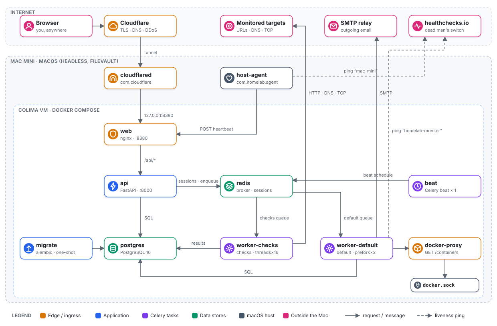

All diagrams in this document are generated from one source file, [`docs/diagrams/build.py`](docs/diagrams/build.py) (see [docs/diagrams/README.md](docs/diagrams/README.md)). Arrows point from the side that opens the connection. Dashed arrows are liveness pings to healthchecks.io.

### Components

| Component | Runs in | Responsibility |
|-----------|---------|----------------|
| **host-agent** | macOS (LaunchDaemon) | Collects boot time, uptime, shutdown cause, load, memory, disk, Colima/cloudflared status; pushes heartbeats to the API; buffers them locally when the API is unreachable; pings healthchecks.io. |
| **web** | compose | nginx: serves the Angular build and reverse-proxies `/api` to the API. The **only** published port (`127.0.0.1:${WEB_PORT}`, default `8380`). |
| **api** | compose | FastAPI: auth and sessions, dashboard and monitor endpoints, agent ingest. Stateless; internal network only. |
| **worker-checks** | compose | Celery worker, `checks` queue, threads pool (concurrency 16) for I/O-bound monitor checks. |
| **worker-default** | compose | Celery worker, `default` queue, prefork pool (concurrency 2): scheduling, host evaluation, container snapshots, alerts, rollups, pruning. |
| **beat** | compose | Celery beat, exactly one replica; fixed schedule in code, including the minute-by-minute healthchecks.io ping that worker-default sends. |
| **migrate** | compose | One-shot `alembic upgrade head` before api/workers start. |
| **postgres** | compose | PostgreSQL 16, system of record. Named volume. |
| **redis** | compose | Redis 7: Celery broker, login sessions, short-lived locks and status cache. Password-protected, internal only. |
| **docker-proxy** | compose | Docker socket proxy allowing only `GET /containers/*`; reachable only by `worker-default`. |

### Component cards

One card per component: where it runs, what it is responsible for, and who it talks to (`→` it opens the connection, `←` it receives it).

**Ingress: from the internet to the API**

<p>
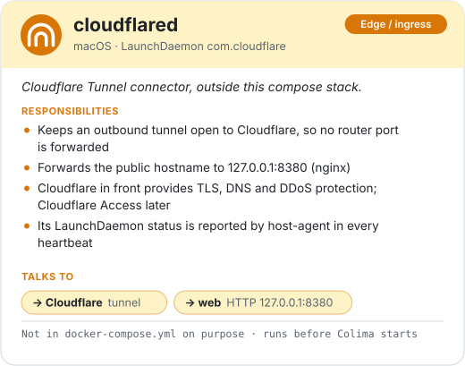
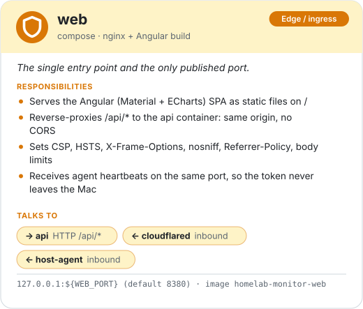
</p>

**Application**

<p>
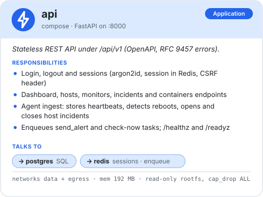
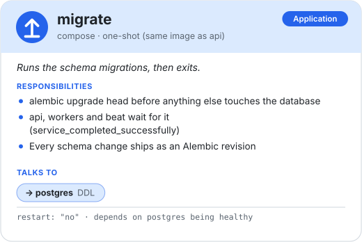
</p>

**Background work (Celery)**

<p>
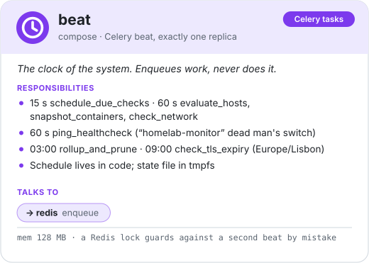
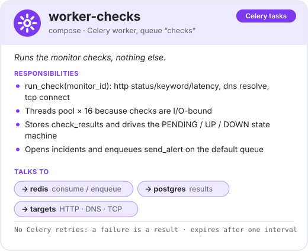
</p>
<p>
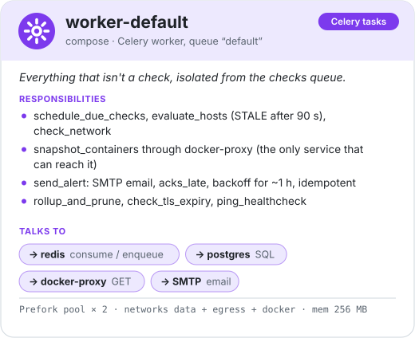
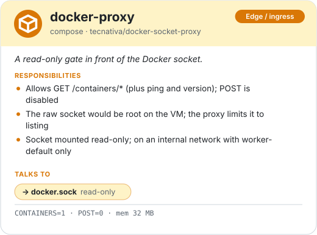
</p>

**Data stores**

<p>
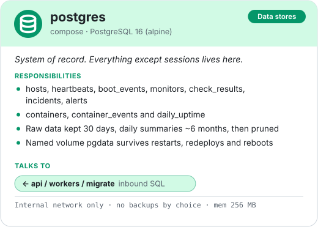
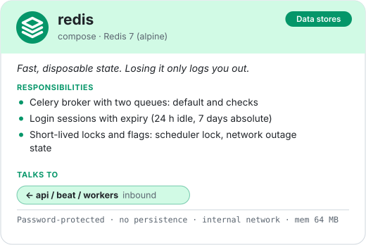
</p>

**On the Mac, outside Colima, and outside the Mac**

<p>
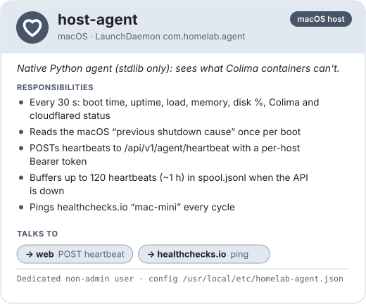
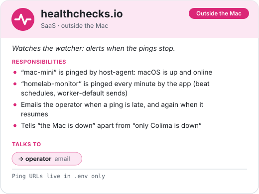
</p>
<p>
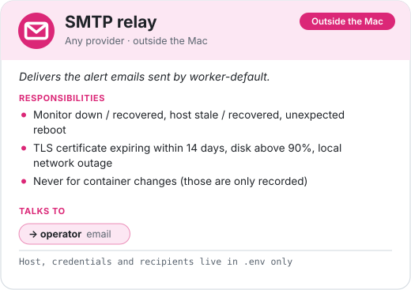
</p>

### Networks and start order

Compose networks decide who can reach whom. `data` and `docker` are internal (no route out of the VM).

| Network | Internal | Members | Why |
|---------|----------|---------|-----|
| `data` | yes | postgres, redis, api, migrate, beat, worker-checks, worker-default | Postgres and Redis are never reachable from outside. |
| `egress` | no | api, migrate, beat, worker-checks, worker-default | Outbound only: checks, SMTP, healthchecks.io. Nothing publishes a port here. |
| `docker` | yes | docker-proxy, worker-default | Only worker-default can ask for the container list. |

`web` (nginx) joins with the frontend and is the only service that publishes a port (`127.0.0.1:${WEB_PORT}`).

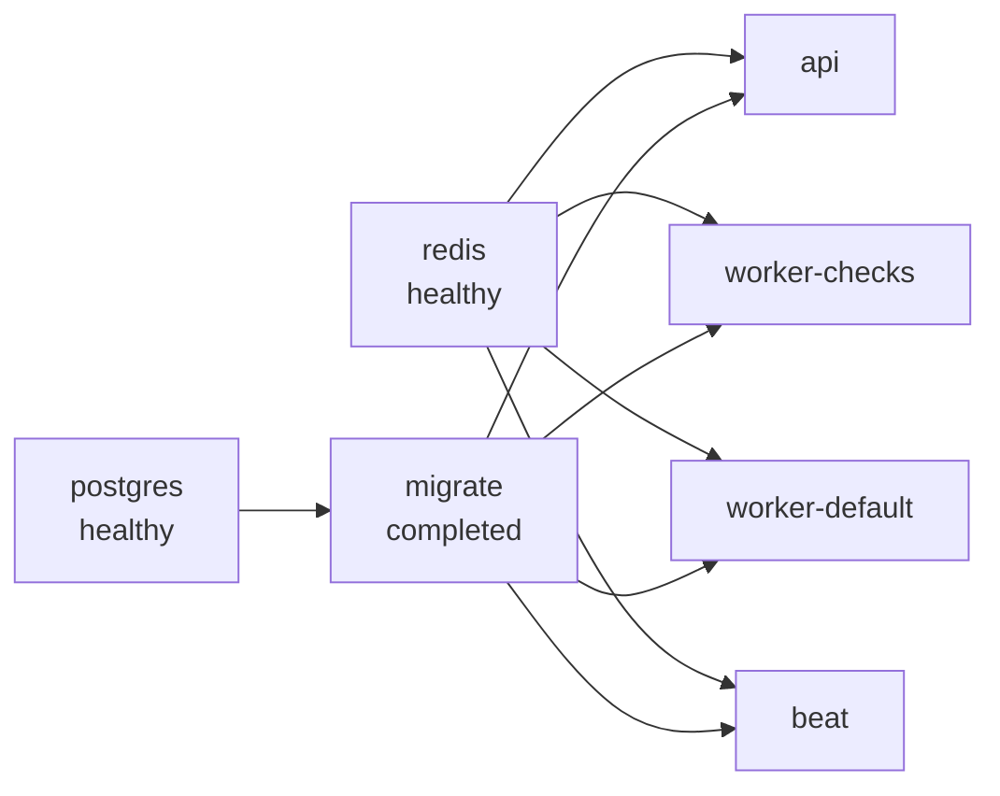

`migrate` must finish (`service_completed_successfully`) and Redis must be healthy before the API, workers and beat start. On the Mac the boot order is: FileVault unlock → Colima LaunchDaemon → Docker restarts containers, while cloudflared and host-agent start as their own LaunchDaemons.

### Key design choices

1. **Push-based host agent.** Colima containers cannot read macOS boot data (C2), so the host pushes it to us.
2. **Single entry point (nginx).** SPA and API share one origin: no CORS, HttpOnly session cookies instead of browser-stored tokens.
3. **Alert on state transitions with confirmation.** DOWN after 2 consecutive failures, UP after 1 success; one email per incident and one on recovery.
4. **Docker socket behind a read-only proxy.** The raw socket is root on the VM; the proxy limits it to listing containers.
5. **Generated API client.** The Angular client is generated from FastAPI's OpenAPI spec (`ng-openapi-gen`), and CI checks the committed spec, so frontend and backend can't drift.
6. **Two external dead-man's switches.** Distinguish "the Mac is down" from "Colima/the app is down" (§9).

### Technology

| Layer | Choice |
|-------|--------|
| Backend | Python 3, FastAPI, Pydantic v2, SQLAlchemy 2, Alembic, httpx |
| Tasks | Celery with Redis broker |
| Database | PostgreSQL 16 |
| Frontend | Angular (latest stable; standalone components, signals, lazy routes), Angular Material, ECharts via `ngx-echarts` |
| Edge | nginx, Cloudflare Tunnel |
| Host agent | Python script + macOS LaunchDaemon |
| Runtime | Docker Compose on Colima (Apple Silicon, `linux/arm64`) |

## 5. Data flows

The main flows are drawn as **animated SVGs** on the same map as §4: an orange dot is a request or task message, red is the failure / alert path, green is a success or reply, and the panel at the bottom narrates each step. GIF copies live in [`docs/diagrams/gif/`](docs/diagrams/gif/) for places that don't play SVG animation, and [docs/diagrams/README.md](docs/diagrams/README.md) explains how to regenerate them.

### 5.1 Monitor check


1. Every 15 s, `schedule_due_checks` selects monitors with `next_check_at <= now()` using `FOR UPDATE SKIP LOCKED`, advances `next_check_at`, and enqueues `run_check(monitor_id)` on the `checks` queue (with up to 10 s jitter on catch-up after downtime).
2. `run_check` performs the check by type (`http`: status/keyword/latency/TLS expiry; `dns`: resolve and optionally match the record; `tcp`: connect to host:port) and stores a `check_results` row.
3. The monitor's state machine updates: `PENDING → UP / DOWN`; DOWN requires `failure_threshold` (default 2) consecutive failures.
4. On a transition, an incident is opened or closed and `send_alert` is enqueued.
5. Every 60 s `check_network` probes known-good control URLs. If all of them fail twice in a row, a single "local network outage" incident is raised and per-monitor DOWN emails are suppressed while it lasts, so you get one alert instead of N.

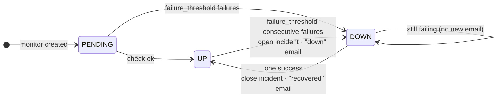

### 5.2 Host heartbeat


1. Every 30 s the agent POSTs `{collected_at, boot_time, uptime, load, memory, disk, daemons, agent_version}` to `http://127.0.0.1:${WEB_PORT}/api/v1/agent/heartbeat` with its Bearer token.
2. The API stores the heartbeat and updates `hosts.last_seen_at` using **server receive time**.
3. If `boot_time` differs from the stored one, a **boot event** is recorded: last heartbeat before the gap (approximate shutdown time), new boot time, downtime, and the macOS "Previous shutdown cause" code, classified as `clean`, `unexpected` or `unknown`. An `unexpected` boot triggers an email.
4. **Local buffering:** if the API is unreachable (e.g. Colima down), the agent appends heartbeats to a local spool file (capped at ~1 h / 120 entries, oldest dropped) and flushes them in a batch when the API returns. History graphs use `collected_at`; liveness uses `received_at`, so a late backlog never makes a host look alive.

### 5.3 Host evaluation

Every 60 s, `evaluate_hosts` marks a host STALE if no heartbeat arrived for 90 s and opens an incident; the next heartbeat closes it. Disk usage is checked on every heartbeat: above 90% opens a disk incident and sends one email, and it closes once usage drops below 85%.

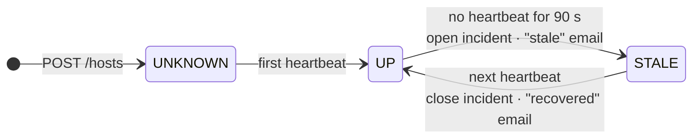

### 5.4 Container snapshot

Every 60 s, `snapshot_containers` lists all containers through the socket proxy, upserts the current-state table and records only **changes** (started, stopped, unhealthy, removed) as `container_events`. No email is sent for container changes.


### 5.5 Alerts

`send_alert(alert_id)` sends email via SMTP. An `alerts` row with a unique key per incident/boot event and kind makes sends idempotent; SMTP failures retry with exponential backoff for about an hour, after which the alert is marked `failed` and surfaced on the dashboard.

### 5.6 Daily maintenance (Europe/Lisbon)

- **03:00** `rollup_and_prune`: compute yesterday's uptime % per monitor and host into `daily_uptime`; delete raw data older than 30 days and summaries older than 6 months.
- **09:00** `check_tls_expiry`: alert for certificates expiring within 14 days.

### 5.7 External liveness pings

| healthchecks.io check | Pinged by | Every | Meaning |
|-----------------------|-----------|-------|---------|
| `mac-mini` | host agent (macOS) | 30 s (every heartbeat cycle) | macOS is running and online |
| `homelab-monitor` | `ping_healthcheck`, scheduled by beat and run by worker-default (Colima) | 1 min | Colima, Docker and the app are running |

healthchecks.io emails the operator when either stops arriving (after a grace period) and again when it resumes.


### 5.8 Dashboard request

How a page load reaches the API from the internet, and why nothing on the Mac listens on a public port.


## 6. Data model

PostgreSQL 16. Conventions: all timestamps `timestamptz` stored in UTC and displayed in Europe/Lisbon; `bigint` identity primary keys; status fields are `text` + `CHECK` constraints (easier to migrate than native enums); all schema changes via Alembic.

| Table | Key columns | Notes |
|-------|-------------|-------|
| `users` | `email`, `password_hash` (argon2id), `last_login_at` | One admin in v1. |
| `hosts` | `name`, `agent_token_hash`, `status`, `last_seen_at`, `current_boot_time`, `os_version`, `agent_version` | Modelled from day one to allow more hosts later. |
| `host_heartbeats` | `host_id`, `collected_at`, `received_at`, `boot_time`, `uptime_s`, `load_1m`, `mem_used_pct`, `disk_used_pct`, `daemons` (jsonb) | ~86k rows per host per 30 days. |
| `boot_events` | `host_id`, `boot_time`, `last_seen_before`, `shutdown_cause_code`, `kind` (clean/unexpected/unknown), `downtime_s` | |
| `monitors` | `name`, `type` (http/dns/tcp), `target`, `config` (jsonb: method, expected status, keyword, record…), `interval_s`, `timeout_s`, `failure_threshold`, `enabled`, `state`, `consecutive_failures`, `next_check_at`, `tls_expires_at` | `enabled = false` pauses a monitor. |
| `check_results` | `monitor_id`, `checked_at`, `ok`, `status_code`, `latency_ms`, `error` | Index `(monitor_id, checked_at DESC)`. |
| `incidents` | `monitor_id` *or* `host_id`, `started_at`, `ended_at`, `cause` | `CHECK` that exactly one FK is set (real FK integrity instead of a polymorphic subject column). |
| `alerts` | `incident_id` *or* `boot_event_id`, `kind`, `status` (pending/sent/failed), `attempts`, `sent_at` | Unique on (subject, kind) to prevent duplicate emails. |
| `containers` | `host_id`, `docker_id`, `name`, `image`, `state`, `health`, `started_at`, `last_seen_at`, `removed_at` | Current state. |
| `container_events` | `container_id`, `at`, `from_state`, `to_state` | Changes only. |
| `daily_uptime` | `monitor_id` *or* `host_id`, `day`, `uptime_pct`, `avg_latency_ms`, `checks_total`, `checks_failed` | Kept 6 months. |

Deleting a monitor is a **hard delete** that cascades to its results, incidents and alerts.

**Not in PostgreSQL:** login sessions live in Redis with expiry (§10). Losing Redis only logs the user out.

## 7. API design

- REST + JSON under `/api/v1`; OpenAPI spec generated by FastAPI; Angular client generated from it.
- Errors follow **RFC 9457** (`application/problem+json`).
- Long lists use **cursor pagination** with `from` / `to` time filters.
- Browser auth: session cookie + CSRF token (Angular's built-in `XSRF-TOKEN` cookie / `X-XSRF-TOKEN` header). Agent auth: Bearer token.

| Area | Endpoints |
|------|-----------|
| Auth | `POST /auth/login` · `POST /auth/logout` · `GET /auth/me` |
| Dashboard | `GET /summary` (host status, uptime, last boot, monitors up/down, open incidents, banners) |
| Hosts | `GET /hosts` · `GET /hosts/{id}` · `GET /hosts/{id}/heartbeats` · `GET /hosts/{id}/boots` · `POST /hosts` (returns agent token once) · `POST /hosts/{id}/rotate-token` |
| Agent | `POST /agent/heartbeat` (single or batched) |
| Monitors | `GET /monitors` · `POST /monitors` · `GET/PATCH/DELETE /monitors/{id}` · `GET /monitors/{id}/results` · `GET /monitors/{id}/uptime?days=30` · `POST /monitors/{id}/check-now` |
| Incidents | `GET /incidents?status=open` |
| Containers | `GET /containers` · `GET /containers/{id}/events` |
| Ops (internal) | `GET /healthz` (liveness) · `GET /readyz` (Postgres + Redis reachable) |

Monitors may target private addresses (e.g. `192.168.x.x`) by design; only the authenticated admin can create them.

## 8. Task design (Celery)

| Task | Trigger | Queue | Retries |
|------|---------|-------|---------|
| `schedule_due_checks` | beat, every 15 s | default | none (idempotent) |
| `run_check(monitor_id)` | enqueued by scheduler / check-now | checks | **none**: a failure is a result; expires after one interval |
| `evaluate_hosts` | beat, every 60 s | default | none (idempotent) |
| `snapshot_containers` | beat, every 60 s | default | none (idempotent) |
| `send_alert(alert_id)` | on state transition | default | exponential backoff + jitter, ~10 attempts over ~1 h, `acks_late` |
| `check_tls_expiry` | beat, daily 09:00 | default | none |
| `rollup_and_prune` | beat, daily 03:00 | default | none (idempotent) |
| `ping_healthcheck` | beat, every 60 s | default | none |

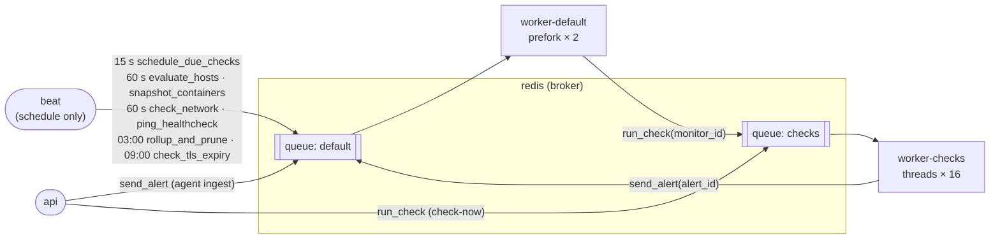

Conventions:

- Two worker containers from the same image so slow maintenance work never delays checks (and vice versa).
- Exactly one beat replica; `schedule_due_checks` also takes a short Redis lock as a guard.
- JSON serialization only; task results ignored (no result backend), outcomes are written to Postgres.
- Time limits: `run_check` = monitor timeout + 5 s; other tasks 60 s.
- Tasks receive IDs, never ORM objects, and reload fresh state from the database.
- Beat timezone: Europe/Lisbon.

## 9. Failure modes and known limitations

| Failure | Detection | Behaviour / recovery |
|---------|-----------|----------------------|
| Power cut / host off | `mac-mini` and `homelab-monitor` pings stop → healthchecks.io emails | On return (after FileVault unlock) a boot event is recorded with shutdown cause and downtime; "unexpected reboot" email. |
| Colima or the app down, macOS up | `homelab-monitor` ping stops, `mac-mini` continues | Agent buffers heartbeats (~1 h) and flushes on recovery; history shows the host up and Colima down. |
| PostgreSQL down | `readyz` fails | Checks in that window are lost (acceptable); restart policy + healthchecks bring it back. |
| Redis down | `readyz` fails | Scheduling pauses and the user is logged out; agent heartbeats still persist (API writes directly to Postgres). |
| Checks stalled (stuck worker, broken beat) | No new results for 3 intervals | Dashboard shows a "monitoring is stale" banner instead of false green. |
| SMTP failing | `send_alert` keeps failing | Retries ~1 h, then `failed` and a dashboard banner. |
| Home internet / DNS down | Most monitors fail + control check fails | One "local network outage" alert instead of N. |
| Cloudflare Tunnel down | Agent reports cloudflared down; public-URL monitors fail | Monitoring continues internally; dashboard unreachable from outside. |
| Agent clock skew | n/a | Liveness uses server receive time. |
| Flapping target | n/a | Failure threshold + recovery alerts limit noise. |
| Disk filling up | Agent disk % > 90 | Email alert; container log rotation and data pruning bound our own usage. |

**Known limitations (accepted for v1):** single host, single database, no replicas; no backups (§11); live alerting of a full host outage depends on healthchecks.io.

## 10. Security

**Threat model.** The dashboard is on the public internet. Main risks: login brute force, information disclosure about the home network, theft of the agent token to forge heartbeats, and abuse of the Docker socket to take over the VM.

- **Edge:** Cloudflare provides TLS and DDoS protection (Cloudflare Access planned). nginx sets CSP, HSTS, `X-Frame-Options: DENY`, `X-Content-Type-Options: nosniff`, `Referrer-Policy`, and body-size limits, and serves only `/` and `/api` (the OpenAPI docs are not published).
- **Authentication:** no signup and no default credentials; the admin is created with `python -m app.cli create-admin`. Passwords hashed with argon2id. 256-bit random session IDs in Redis; cookie `HttpOnly; Secure; SameSite=Strict`; 7-day absolute and 24 h idle expiry; ID rotated on login; server-side logout. CSRF protection on state-changing requests. Login rate limited (5/min per IP via `CF-Connecting-IP`); failed and successful attempts logged; failures return the same generic error for unknown emails and wrong passwords.
- **Agent:** per-host 32-byte random token, stored as SHA-256, shown once, rotatable. The agent talks to `127.0.0.1` only, so the token never crosses the internet. Strict schema validation, size and rate limits on the ingest endpoint. Runs as a dedicated non-admin user.
- **Containers:** non-root users, `no-new-privileges`, `cap_drop: ALL`, read-only root filesystem where possible. Only `web` publishes a port, on `127.0.0.1`. Postgres and Redis on internal networks; Redis requires a password. The Docker socket proxy permits only `GET /containers/*` and sits on a network reachable only by `worker-default`.
- **Secrets:** all secrets and personal settings (DB/Redis passwords, SMTP credentials, healthchecks.io URLs, alert recipients) live in `.env`, which is git-ignored; the repo ships `.env.example` only.
- **Supply chain:** pinned dependencies with lock files; Dependabot; `pip-audit` and `npm audit` in CI.

## 11. Deployment and operations

### Repository layout

```
backend/     FastAPI app, Celery tasks, Alembic migrations, tests
frontend/    Angular app
agent/       macOS host agent, LaunchDaemon plist, install script
deploy/      nginx configuration
docker-compose.yml
.env.example
Makefile
.github/workflows/
```

### Build and release

- On every push to `main`, GitHub Actions runs lint, tests and dependency audits, then builds two `linux/arm64` images on native arm64 runners and pushes them to GHCR:
  - `ghcr.io/izzypt/homelab-monitor-api` (used by api, workers, beat, migrate)
  - `ghcr.io/izzypt/homelab-monitor-web` (nginx + Angular build)
- Images are tagged with the git SHA and `main`; the build uses the GitHub Actions cache.

### Deploy (manual)

```bash
ssh macmini
cd homelab-monitor
make deploy TAG=<git-sha>     # compose pull + migrate + up -d --wait
make rollback TAG=<prev-sha>  # same command, previous tag (see .deploy-history)
```

Migrations are forward-only, so a rollback keeps the newer schema; keep migrations additive so the previous image still runs against it.

There is no auto-deploy: a self-hosted runner on the Mac would execute code from a public repository.

### Runtime

- `migrate` must complete before `api`, workers and `beat` start (`service_completed_successfully`).
- Every long-running service: `restart: unless-stopped`, a healthcheck, `depends_on: condition: service_healthy`, a memory limit, and log rotation (10 MB × 3).
- Structured JSON logs to stdout (`docker compose logs`).
- Boot sequence: FileVault unlock → Colima LaunchDaemon starts the VM → Docker restarts containers → host-agent LaunchDaemon (KeepAlive) starts in parallel.

### Data persistence and backups

PostgreSQL data lives in a named Docker volume inside the Colima VM. It survives container restarts, redeploys, `colima stop/start`, Colima crashes and host reboots. It is lost only if deliberately deleted (`docker compose down -v`, or deleting the Colima VM's data disk). **No backups by choice**: history is short-lived and monitors are quick to recreate.

### Configuration

All configuration via environment variables (`.env`, loaded with pydantic-settings), including `WEB_PORT` (default `8380`), check defaults, retention periods, SMTP settings, alert recipients and healthchecks.io ping URLs.

### Local development

`compose.dev.yml` (`make dev`) enables API hot reload on `127.0.0.1:8000`; `npm start` in `frontend/` serves the Angular app and proxies `/api` to it.

## 12. Decision log and future work

### Decisions

| # | Decision | Rationale | Alternatives considered |
|---|----------|-----------|-------------------------|
| D1 | Redis as Celery broker | Simple, also serves sessions and locks | RabbitMQ |
| D2 | Push-based native host agent | Containers in Colima can't see macOS boot data | Reading VM data, SSH polling from a container |
| D3 | Docker socket behind a read-only proxy | Raw socket = root on the VM | Mounting the socket directly |
| D4 | Angular + Angular Material SPA behind nginx | Rich UI, learning goal; single origin | Server-rendered Jinja/htmx, PrimeNG |
| D5 | ECharts (`ngx-echarts`) for charts | Angular Material has no charts | Chart.js, ngx-charts |
| D6 | Sessions in Redis with HttpOnly cookie | Revocable; no tokens in the browser | JWT in local storage |
| D7 | Two Celery queues / worker containers | Isolate I/O-bound checks from maintenance work | Single worker |
| D8 | Two healthchecks.io dead-man's switches | Live alert for host or Colima outage; tell them apart | DNS check (cannot detect it), no external check |
| D9 | Monitor types http / dns / tcp + TLS expiry | Cover non-HTTP services and DNS breakage | HTTP only |
| D10 | Email alerts only, no container alerts | Simple SMTP; avoid noise | WhatsApp (Business API/Twilio) |
| D11 | Images built in GitHub Actions → GHCR, manual deploy | Reproducible builds; no runner on the Mac | Build on the Mac, auto-deploy |
| D12 | Bounded retention (30 days raw, 6 months summaries), no backups | No data kept forever; low-value data | Indefinite history, daily `pg_dump` |
| D13 | Login on a public site, Cloudflare Access later | Protects the dashboard now | Public read-only dashboard |

### Future work

- Cloudflare Access in front of the dashboard.
- WhatsApp alert channel.
- Server-sent events for instant dashboard updates.
- Optional agent auto-restart of Colima after prolonged downtime.
- Monitoring additional hosts.
